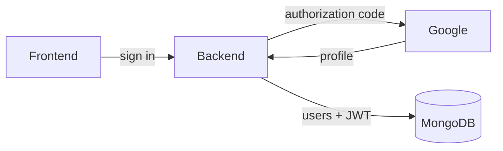
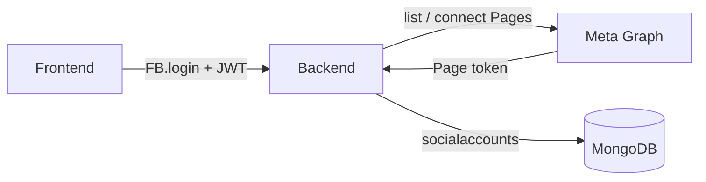

# Architecture

## System overview

```
┌─────────────┐      ┌──────────────────┐      ┌────────────────┐
│  Next.js 14 │──────▶  Express API GW  │──────▶  Flask AI svc   │
│  (frontend) │◀──────│  (backend)       │◀──────│  (ai-service)  │
└─────────────┘      └────────┬─────────┘      └────────┬────────┘
                               │                          │
                               ▼                          ▼
                     ┌──────────────────┐          ┌──────────┐
                     │ MongoDB          │          │  Groq /  │
                     │ users, accounts, │          │  OpenAI  │
                     │ drafts, posts    │          └──────────┘
                     └────────┬─────────┘
                               │
                               ▼
                     ┌──────────────────────┐
                     │ Meta Graph API        │
                     │ (Facebook + Instagram)│
                     │ or sandbox simulator  │
                     └──────────────────────┘
```

## OAuth login (app identity)

Google (or email/password) signs the user into SteadyPost. Meta is not
involved. The backend never sends Google's tokens to the browser — only
SteadyPost JWTs.



The frontend starts `GET /api/v1/auth/oauth/google`. The backend redirects
to Google, exchanges the code on `GET /api/v1/auth/oauth/google/callback`,
creates or links the user, and redirects to `/auth/callback` with access
(15m) and refresh (7d) JWTs. Those tokens live in `localStorage`. Email
login is the same end state via `POST /api/v1/auth/login`.

## Meta Graph API (social-account connect)

This hop requires an existing JWT from login above. Facebook Login for
Business runs in the browser (`FB.login({ config_id })` in
[`frontend/lib/facebookSdk.js`](../frontend/lib/facebookSdk.js)); the backend
only talks to Graph and stores the Page token.



`POST /api/v1/auth/oauth/meta/pages` lists Pages (`/me/accounts`,
`/me/businesses`, `/{business}/owned_pages`). `POST /api/v1/auth/oauth/meta/connect`
loads `/{pageId}` and stores the **Page access token** on `socialaccounts`.
A linked Instagram Business account is a second row with the same token.
The browser never sees that token (`isLive` is sent instead). Requires
`NEXT_PUBLIC_META_APP_ID` / `NEXT_PUBLIC_META_LOGIN_CONFIG_ID`; otherwise
the UI can attach a sandbox account with no token. Live publish later
reuses the stored Page token against `/feed`, `/photos`, or IG `/media`.

## Data layer

Users, social accounts, content drafts, and publish-status records live in
MongoDB (`MONGODB_URI`), via the Mongoose models under
[`backend/src/models/`](../backend/src/models/). A demo user, two sandbox
social accounts, and a sample draft are seeded once at boot
([`backend/src/data/seed.js`](../backend/src/data/seed.js)) if they do not
already exist.

The publish job and metrics collection are handled by a unified queue architecture
([`backend/src/queue/`](../backend/src/queue/)). When Redis is configured (`REDIS_URL` or
`REDIS_HOST`), BullMQ (`bullmq`) manages distributed scheduling and workers. In local dev
and test environments without Redis, an in-memory event-driven queue (`InMemoryJobQueue`)
provides identical semantics with exponential backoff retries, delayed scheduling, and job cancellation.

## Publishing engine flow (#10)

1. User/owner triggers publishing via `/posts/publish-approved`, `/posts/:id/publish-now`,
   or `/publish/now`.
2. Workspace ownership check (`validateAccountWorkspaceOwnership` in
   [`backend/src/utils/workspaceValidation.js`](../backend/src/utils/workspaceValidation.js)):
   ensures each selected social account belongs to the requester's active workspace before
   queuing, preventing cross-tenant publishing vulnerabilities. Role-based access enforces
   that only workspace owners can trigger publication.
3. Post state updates to `scheduled` (or `publishing`), and a job is queued via
   `enqueuePublishJob(...)`. If a future `scheduledAt` timestamp is provided, execution is
   delayed by `scheduledAt - now`; otherwise delay is 0.
4. The queue worker (`publishProcessor.js`) executes the job:
   - Resolves workspace credentials for the target platform.
   - Looks up the platform adapter from `adapterRegistry` (`MetaAdapter`, `TwitterAdapter`,
     `LinkedInAdapter`, `GbpAdapter` for GBP Local Posts #13).
   - Calls the adapter's `publish(...)` method. In live mode with credentials, calls the
     real platform API; in sandbox mode, safely simulates publishing and returns a mock external ID.
   - On success: marks post as `published`, sets `publishedAt` and `externalPostId`.
   - On failure: retries with exponential backoff up to `maxRetries` (default 3). If all retries
     exhaust, marks post as `failed` with descriptive `errorMessage`.
5. Metrics collection:
   - Immediately following successful publication, the adapter's `getMetrics(...)` is invoked
     to collect initial engagement metrics (reach, likes, comments, shares, clicks), persisted
     to `PostMetrics`.
   - Periodic or delayed metrics jobs are enqueued via `enqueueMetricsJob(...)` to track post
     performance over time.

## Platform adapter architecture

Every publishing channel inherits from `BaseAdapter`
([`backend/src/services/publishers/BaseAdapter.js`](../backend/src/services/publishers/BaseAdapter.js)):
- **Consistent interface**: `publish(params)`, `getMetrics(params)`, `validateCredentials(account)`.
- **Swappable & mockable**: Registered in `adapterRegistry`, enabling unit tests to swap or mock
  adapters without hitting external APIs or network dependencies.
- **Unified omnichannel channels**:
  - Meta (`facebook`, `instagram`)
  - Twitter / X (`twitter`)
  - LinkedIn (`linkedin`)
  - Google Business Profile (`gbp`) for Local Posts (#13) with CTA buttons and offers.

## AI microservice boundary

The AI service is deliberately isolated from the core backend:
- Different language/runtime (Python) suits the LLM ecosystem (OpenAI-
  compatible SDK against Groq) better than Node.
- It's a stateless request/response service — no data store, no shared
  state with the backend.
- The Express backend proxies all AI calls (`/api/v1/ai/*`) rather than the
  frontend calling the AI service directly, keeping JWT auth and rate
  limiting in one place.
- Two independent fallback layers exist so the demo never hard-fails: the
  AI service itself falls back to a template generator if no
  `GROQ_API_KEY`/`OPENAI_API_KEY` is set, and the backend's `ai.controller.js`
  falls back to its own built-in generator if the AI service is unreachable
  at all.

## Media uploads

`POST /api/v1/content/media` accepts one image or video file (multer,
in-memory buffer, 25MB limit) and returns it as a base64 `data:` URL. There
is no object storage — the encoded file is only ever held in the browser's
state and the request/response cycle. This is why media doesn't survive a
page refresh: it was never written anywhere durable.

## Known limitations (intentional at this stage)

- No object storage for uploaded media (base64 in memory only).
- When running in local development mode without Redis, in-memory queue timers
  do not persist across process restarts; in production with `REDIS_URL` or
  `REDIS_HOST`, BullMQ provides durable persistence.
- Sandbox social accounts (no live token) run against the sandbox simulators.
- Live Instagram publish sends `image_url`; uploads in this app are `data:`
  URLs, which Graph cannot fetch. Facebook `/photos` already uploads those
  as multipart `source`.
